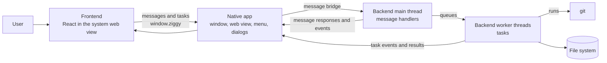

# Graft architecture

How Graft is built: its parts, how they fit together and why. For how to set up and develop it, see [development.md](development.md). For what it does, see the spec in [spec/](spec/README.md).

## Overview

Graft is a Ziggy app. A React frontend runs in the system web view and holds most of the code. A Zig backend does everything that touches Git, the file system or the computer. A native app for each platform opens the window, hosts the web view and carries messages between the two. The split is the line between what can be drawn and decided in the page and what has to reach outside it: the frontend asks, the backend does the work and answers.

High level overview of the project:

## Components

### Frontend

- Lives in `frontend/`. TypeScript, React, TanStack, MaterialUI, Tailwind and Font Awesome icons, bundled by Vite and embedded in the app.
- Owns everything the user sees: the pages, the layout and the state of the window.
- Keeps its logic in plain functions under `src/lib/`, so the UI is a thin layer over unit tested code.
- Must not reach Git, the file system or the computer. It asks the backend through `window.ziggy`.

### Backend

- Lives in `backend/`. Zig, declared to Ziggy in `backend/src/app.zig`.
- Owns every call to `git`, every file read and write and anything else that reaches the computer.
- Message handlers run on the backend's main thread and answer quickly. Anything slow is a task on a worker thread.
- Starts `git` through one Git interface function, `run_git` in `backend/src/lib/git-interface.zig`. It starts `git` with the arguments it is given and reports the exit code, standard output and standard error. Every other piece of backend code that needs Git calls it.
- Wraps each Git command in a function that builds its arguments and parses its output, such as the `log` wrapper in `backend/src/lib/git-log.zig`. A wrapper takes the Git interface function as an argument, so its unit tests pass a mock.
- The `log` wrapper reads one page of commits at a time with `git log -z`, its fields split by the unit separator (0x1f). A later page starts from the last commit of the previous page and skips it, so a new commit on top does not shift the pages.
- Must not share state between threads or use locks.

### Native apps

- Live in `native/<platform>/`, each built on the native app Ziggy provides: a Zig executable on Linux (WebKitGTK) and Windows (WebView2) and Swift on macOS (WKWebView).
- Own the window, the system web view, the desktop menu, native dialogs and the message bridge.
- Must not hold Graft's logic. They carry messages without reading them.

### Ziggy

- A dependency, locked to a release tag in `package.json` and `build.zig.zon`. It provides the core library (message bridge, task runner, test hooks), the native apps and Ziggy's frontend types.
- Graft owns the code that came from the Ziggy template and changes it freely. It does not change Ziggy itself.

## How the components talk to each other

- The frontend sends a message with `window.ziggy.invoke(name, data)` and gets a message response back, or queues a task with `window.ziggy.addTask` and hears its progress through `onTaskEvent` and its end through `onTaskCompleted`.
- The native app passes each message to the backend through Ziggy's C interface. The backend's main thread finds the handler registered for its name and sends back what it returns.
- A message handler can have a task give its response, so a slow answer still reaches the frontend as one message response.
- The backend sends the frontend events of its own with `sendEvent`. The native app sends a menu item the frontend runs as a menu event.
- Every message, response and event is the JSON text of one object.

## Where work runs

- The UI thread belongs to the native app and the web view. It only draws and passes messages on.
- The backend's main thread runs message handlers, menu functions and timers. It does quick work only, such as answering from state it already holds or queuing a task.
- Every expensive operation (running `git`, walking a folder, reading a large file, reaching the network) is a Ziggy task on the backend's pool of worker threads. A task the user is waiting on is queued as `interactive`, which puts it at the head of the queue. Everything else is `background`.
- A task gets its input as JSON when it is queued, reports with `sendEvent`, ends with its result and is cancelled by its source with `cancelTasks`. A task that loops calls `checkCancelled()` at every step.
- Threads keep their own state and talk only by messages. A lock in the code means this rule is being broken.

## Data flow

A user action that needs data from Git:

1. The frontend queues a task as `interactive` and shows that it is loading.
2. The native app passes the `add-task` message to the backend, which queues the task.
3. A worker thread runs the task. It calls the Git interface function, which starts `git` in the repo's folder and reads its output.
4. The task parses the output and returns it as its result.
5. The native app delivers the `task-completed` event to the frontend, which renders the result.
6. If `git` fails, the task fails with an error that says what went wrong. The frontend shows it.

## User interface

Graft's UI grows one small piece at a time, one ticket at a time. Each page, button, menu and feature exists only once a ticket adds it. The Graft UI mockup guides only the general structure and style of what a ticket adds. It is never copied, and Graft may never have all of its features.

## Key design decisions

- **Ziggy, with the frontend in the system web view.** Graft gets one frontend for every desktop platform, written in TypeScript and React. Everything that reaches the computer is in Zig.
- **All access to Git, the file system and the computer goes through Zig.** The frontend only asks. The backend is the one place that touches the computer. The frontend can be unit tested without it.
- **Expensive work runs in tasks.** Rejected: running it in message handlers, because they share the main thread with every other message and a slow one would hold up the whole UI.
- **Threads share no state.** Rejected: shared state with locks. Threads that talk only by messages need no locks. Each piece of the backend's state belongs to one thread.
- **Graft runs the `git` command.** One Git interface function starts it. Every other unit test mocks that function.
- **A task handler is made with the Git interface function it runs.** Ziggy passes a task handler only its standard arguments, so `commits_task_handler` takes the Git interface function at compile time: the app registers the handler made with `run_git` and a unit test registers one made with the mock. Rejected: a global holding the function, which tests would have to swap.
- **No Git interfaces, abstractions or mocks until a feature needs them.** Rejected: designing them upfront, which is overengineering for features that do not exist yet.
- **Graft owns the template code and depends on Ziggy.** The template is a starting point to change freely. Ziggy is upgraded with `/ziggy:upgrade`.
- **One process per window.** Several instances of Graft can run at once, for example on different virtual desktops. Each is a separate process with one window, so instances share no state in memory.

## Constraints

- Every access to Git, the file system and the computer goes through the Zig backend.
- Expensive work never runs on the backend's main thread or the UI thread.
- Threads share no state and use no locks. They talk only by messages, as JSON or binary.
- Standard services such as IO and the allocator, as well as Graft's own services, are passed to functions as parameters and are not stored in structs.
- Several instances run at once, each a separate process with one window. Anything Graft keeps on disk must allow for that.
- Graft runs on Linux, Windows and macOS (Intel and Apple silicon).
- Release builds never contain the test hooks.

## Similar products

- **Other Git clients.** Graft follows their conventions for commits, branches, staging and history, so it is familiar from the first use. It differs where the developer's own use shows a better way. It is customised for the developer's workflow.
- **GitHub's web pages for commits and branches.** Graft follows how they lay out a commit with its changed files and diff. It also follows how they list branches. It differs by working on the local repo through `git`, as a desktop app.

## Related docs

- [development.md](development.md): how to develop, test and contribute.
- [setup.md](setup.md): how to set up the project and a worktree.
- [spec/README.md](spec/README.md): what the system does, feature by feature.
- Ziggy's [architecture](https://github.com/ashleydavis/ziggy/blob/v0.0.19/docs/development/architecture.md): the message bridge, tasks, menus and test hooks in detail.
